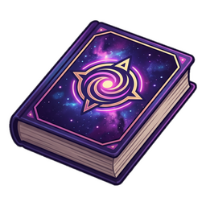
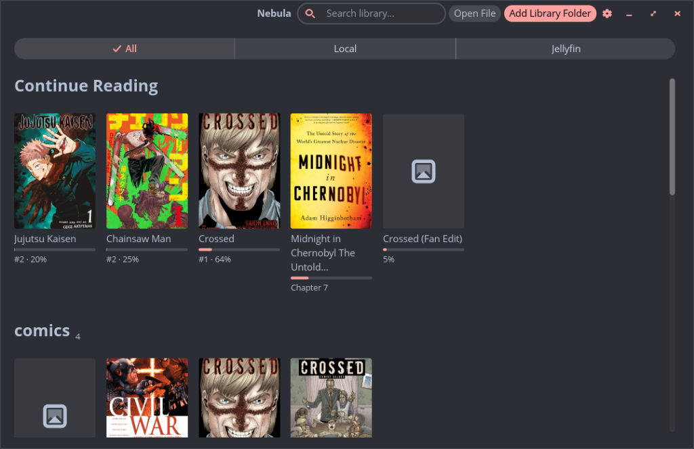
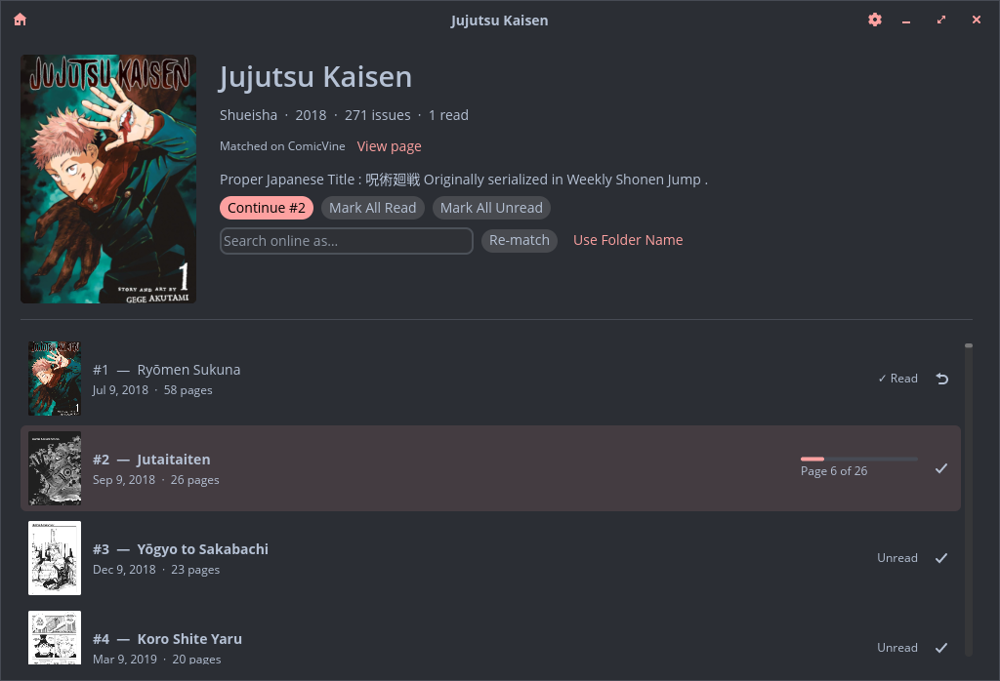
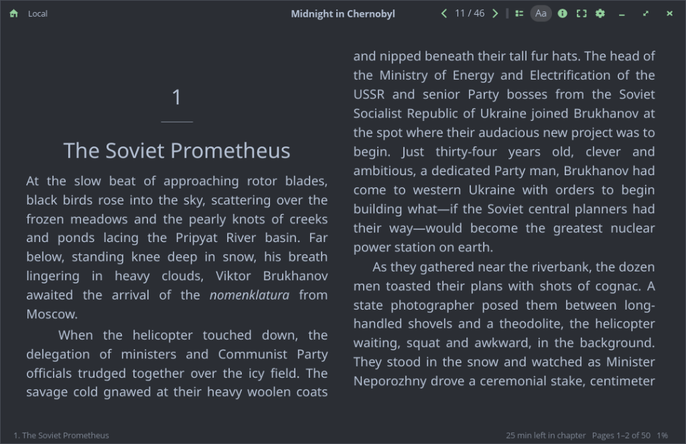
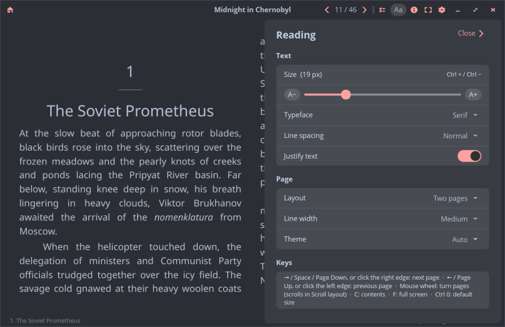
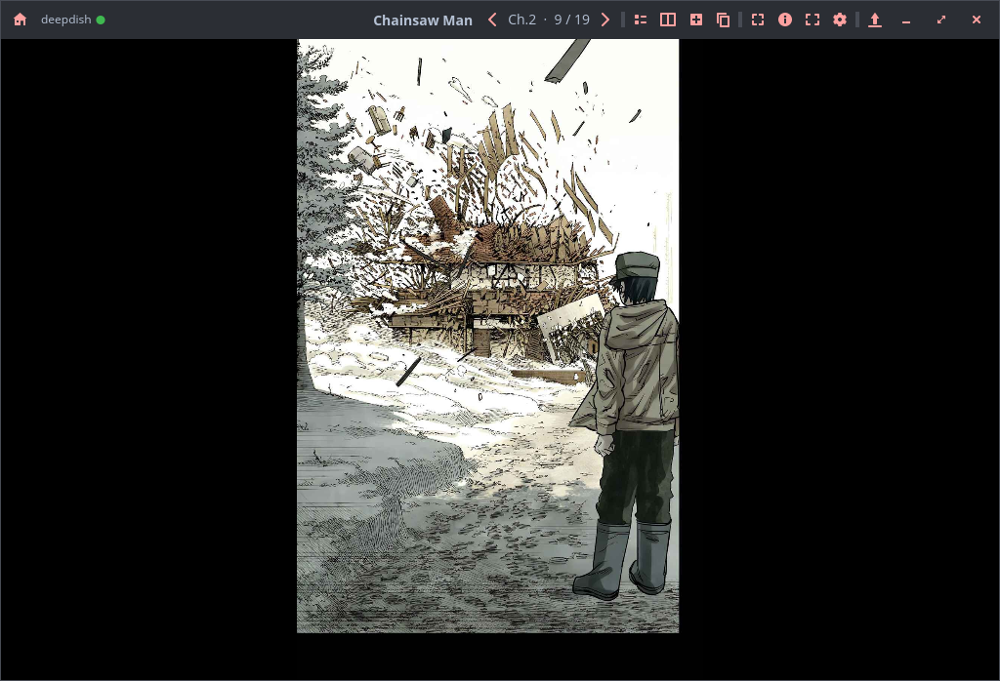
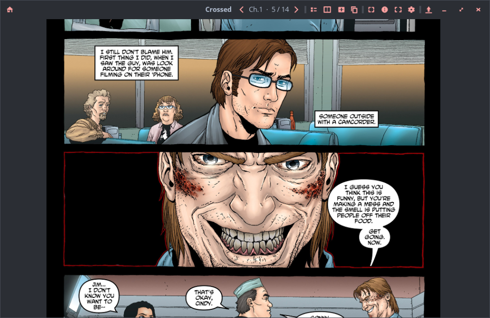
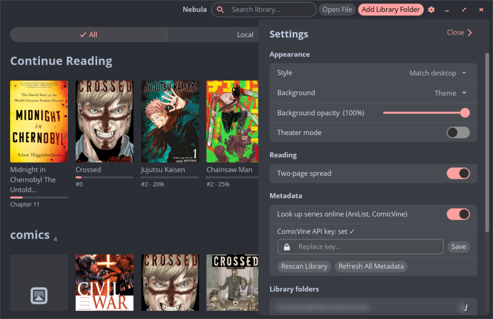

<p align="center">
  
</p>

<h1 align="center">Nebula Reader</h1>

<p align="center">
  <b>Comics, manga and books in one library.</b><br>
  Made for the COSMIC desktop, at home on KDE Plasma, GNOME, Windows and macOS.
</p>

<p align="center">
  <a href="https://github.com/NotTimm/NebulaReader/releases/latest"></a>
  <a href="LICENSE"></a>
  
  <a href="CONTRIBUTING.md"></a>
</p>

<p align="center">
  
</p>

Point Nebula at the folders your collection already lives in, or sign in
to your Jellyfin server, and it builds a library of series with covers,
progress and a **Continue Reading** shelf. Messy file names are cleaned up
and matched online for proper titles and descriptions. Then it gets out of
the way so you can read.

> Nebula Reader was called **Cosmic Comic** up to 0.1.0-beta.4. Upgrading
> keeps your library, progress and settings: the first start moves them over.

## Highlights

### 📚 One library for everything

- Add the folders you already have. Series folders, loose issues, chapter
  folders of images and manga downloader layouts
  (`Title/English/Ch N ….cbz`) are all recognised and grouped into series.
- Names are tidied offline (`Civil War 001-007 (2006-2007) GetComics.INFO`
  becomes `Civil War`), then matched with **AniList** for manga and
  **ComicVine** for Western comics: canonical titles, descriptions,
  publishers, issue titles and cover dates. Wrong match? Search again with
  your own words.
- Who made it and when: series show their writers and artists and the
  years they ran, issues their release dates, books their author. These
  come from the files themselves (`ComicInfo.xml`, EPUB), Jellyfin,
  AniList and ComicVine.
- Read, unread or "page 12 of 30" for every issue, a Continue Reading
  shelf, and search across the library.
- Every series and one-shot has its own page with the cover, description
  and details; Continue Reading jumps straight back in. Right-click a
  cover to read, download, mark it read, show it in its folder or see its
  **Properties** (format, location, pages, page size, size on disk).
- CBR comics from Jellyfin stream page by page. The first time one is
  opened, Nebula creates an index of its pages ("Creating index of CBR
  comic…") and keeps it, so later opens start right away. Right-click a
  series to build the indexes ahead of time.
- Drag a file or folder onto the window to open it.
- Libraries on a USB drive are kept while the drive is unplugged and come
  back when it's plugged in again.

<p align="center">
  
</p>

### 📖 Books that read like a book

<p align="center">
  
</p>

- EPUBs turn pages like an e-reader: **one page, or two side by side**
  like an open book, or scroll if you prefer. Lines are never cut in half
  at the bottom of a page.
- Print-style typography: justified text, first-line indents, chapter
  openings set lower on the page.
- Pick the typeface, size, line spacing, line width and theme (Paper,
  Sepia, Dark, Night, or follow the desktop).
- Maps and photos fit the page; click one to open it full-window and zoom.
- The book's own table of contents, time left in the chapter and how far
  through the book you are.

<p align="center">
  
</p>

### 🖼️ Comics and manga, your way

<p align="center">
  
</p>

- CBZ, CBR and folders of images, with embedded `ComicInfo.xml`.
- Single or two pages at a time (a two-page spread shows on its own),
  theater mode (a black backdrop, on by default), and Fit Page, which
  sizes the window to the page.
- Full screen hides everything but the page, with the time and battery
  in a corner like an e-reader; move the pointer to the top to bring the
  header bar back.
- Zoom with the mouse wheel (hold Shift for finer steps), Ctrl + scroll
  on a trackpad, or a pinch, and pan by dragging. With a mouse, hold
  Ctrl (Cmd on a Mac) and scroll to move down a zoomed page (add Shift
  to move sideways). On a touchscreen,
  pinch to zoom and drag with one finger to move around; a flick glides
  on. The zoom stays as you
  turn pages, and each new page starts at its top; a two-page spread
  shows whole, and your zoom comes back on the page after it.
- Fit to Width (`Space`, or its button in the header bar) makes a comic
  page as wide as the window, from its top, with a quick snap; scroll
  down to read the rest. It stays on as you turn pages, each starting at
  its top, and `Space` again shows the whole page.
- CBRs open right away: the pages are listed from the archive's headers,
  and it's unpacked in the background as you reach it, then cached, so
  page turns stay instant.
- A chapter list (C) with the whole series, grouped by volume when the
  file names say so (or in blocks of 25), with a dropdown to jump between
  them.
- An info panel with the issue's `ComicInfo.xml` and what was matched
  online.

<p align="center">
  
</p>

### 🪼 Jellyfin built in

Sign in to your Jellyfin server with **Quick Connect** (no password
typing) and its book libraries sit right next to your local folders, with
an **All / Local / Jellyfin** switch at the top. Comic pages stream as you
read instead of downloading whole chapters, and progress syncs both ways
with Jellyfin's own web reader. The title bar shows which server a comic
comes from and whether it's online, and what you're reading shows on the
server's dashboard. **Download** whole series or single chapters to read
when the server can't be reached. [How it works](#jellyfin)

### 📡 OPDS catalogs (new, untested)

Add an OPDS catalog (Komga, Kavita, calibre-web, Stump and many more
have one), pick the folders you want, and they're synced into your
library just like a Jellyfin library, with streaming, downloads and
offline reading. Everything else in the catalog stays browsable and
searchable. **Not tried against real servers yet**: please
[report](https://github.com/NotTimm/NebulaReader/issues/new/choose) how
it goes with yours. [How it works](#opds-catalogs)

### 🎨 At home on your desktop

<p align="center">
  
</p>

Nebula takes on the look of the desktop it runs on, including your
accent colour, light or dark mode and button shapes, and follows along
when you change them:

| Desktop | Style | Colours from | Title bar |
|---------|-------|--------------|-----------|
| COSMIC | COSMIC | the live COSMIC theme | libcosmic's header bar |
| KDE Plasma | Breeze | your colour scheme (`kdeglobals`), accent included | KWin's |
| Windows 10/11 | Windows 11 (Fluent) | light/dark mode and the accent shades Windows' own apps use | Windows' |
| GNOME, Budgie, ... | Adwaita | light/dark and accent (settings portal) | libcosmic's header bar |
| macOS | Adwaita shapes | light/dark mode and accent colour | macOS's |

Prefer another look? **Settings → Appearance → Style** picks the shapes
and the title bar (the title bar changes the next time Nebula starts);
light/dark mode and the accent colour still come from your system unless
you pick a colour theme below. **Buttons** makes any style round, slightly
round or square (COSMIC takes that from COSMIC Settings).

#### Themes

**Settings → Appearance → Colors** switches from your system's colours to
a theme. Built in: COSMIC Dark and Light, Catppuccin Mocha and Latte,
Nord, Dracula, Gruvbox Dark and Solarized Light.

Bring your own in a format you may already have:

- **COSMIC themes** (`.ron`): export one from COSMIC Settings
  (Appearance → Export) or download one from
  [cosmic-themes.org](https://cosmic-themes.org).
- **KDE colour schemes** (`.colors`): from System Settings → Colors or the
  KDE Store.

Use **Import Theme…**, or drop files into the themes folder (**Open Themes
Folder**). The built-in themes are COSMIC `.ron` files in
[`res/themes/`](res/themes), handy to copy and edit. A theme changes
colours only; the Style setting still picks shapes and the title bar.

#### Languages

Nebula speaks **English** and **Spanish**, following your system's
language. **Settings → Appearance → Language** picks another one, and the
whole window switches straight away. More languages are a text file away:
see [how to translate Nebula](i18n/README.md).

## Download

Grab a package from the
[latest release](https://github.com/NotTimm/NebulaReader/releases/latest):

| Your system | Download | Install |
|-------------|----------|---------|
| **Fedora** | `nebula-reader-<version>-1.fc<NN>.x86_64.rpm` | `sudo dnf install ./nebula-reader-*.x86_64.rpm` |
| **Ubuntu, Pop!_OS, Debian** (24.04+) | `nebula-reader_<version>_amd64.deb` | `sudo apt install ./nebula-reader_*_amd64.deb` |
| **Any Linux, Flatpak** | `NebulaReader-<version>-x86_64.flatpak` | `flatpak install --user ./NebulaReader-*.flatpak` |
| **Any Linux, AppImage** | `NebulaReader-<version>-x86_64.AppImage` | `chmod +x NebulaReader-*.AppImage`, then run it |
| **Windows 10/11** | `NebulaReader-<version>-windows-x64-setup.exe` | Run it. It installs for your user, no admin needed |
| **Windows, portable** | `NebulaReader-<version>-windows-x64.zip` | Unzip anywhere, run `nebula-reader.exe` |
| **macOS** (Apple Silicon) | `NebulaReader-<version>-macos-arm64.dmg` | Open it, drag Nebula Reader into Applications |

Coming soon: `winget install NotTimm.NebulaReader`, and Flathub (which is
also how apps reach the COSMIC Store).

<details>
<summary>Notes on installing, upgrading and unsigned builds</summary>

- Use `dnf`/`apt` as above rather than `rpm -i`/`dpkg -i`, so the
  libraries it needs (`libarchive`, `libxkbcommon`, `openssl`, ...) come
  along. The `.rpm` and `.deb` also replace an old `cosmic-comic` package.
- **Updates:** Nebula tells you when a new version is out (Settings →
  About has a switch for the check). From 0.1.7 on, on Windows (installer
  or zip) and on the Mac, **Update now** downloads it, checks it's signed
  by the Nebula release key, and restarts into the new version. On the
  Mac that needs the app in Applications, not opened from the disk image.
  Other installs update the usual way for them (see below). The
  `.app.tar.gz` on each release is what the Mac app downloads to update
  itself; you don't need it. Every release file also has a `.minisig`
  signature you can check yourself with
  `minisign -Vm <file> -P RWQxSx3YOrrlrxqPlxFEY6QXstC2sjcXdOCKJNHI1xtIKT1o8nN41ZIV`.
- To upgrade a Linux package, install the newer one the same way. To remove,
  `sudo dnf remove nebula-reader` or `sudo apt remove nebula-reader`. Your
  library and settings are kept either way.
- Windows SmartScreen may warn about an unrecognised app because the
  installer isn't code-signed: **More info → Run anyway**.
- The Mac app isn't notarized, so the first launch is blocked. Open it
  once, then **System Settings → Privacy & Security → Open Anyway** (on
  macOS 14 and older, right-click the app and choose **Open**). Or run
  `xattr -dr com.apple.quarantine "/Applications/Nebula Reader.app"`.
- Beta versions such as `0.1.0-beta.1` are packaged as `0.1.0~beta.1`, so
  they sort before the final release and upgrade cleanly.
- Another distro? Build from source with `./install.sh` (below).

</details>

## Keyboard and mouse

| | Comics | Books |
|---|---|---|
| Next / previous page | `→` `←` `Page Down` `Page Up` | `→` `←` `Page Down` `Page Up` `Space` (`Shift Space` back), mouse wheel, or click the page edge |
| Fit to Width | `Space` (scroll down the page; `Space` again for the whole page) | |
| Scroll a line | | `↓` `↑` |
| Contents / chapters | `C` | `C` |
| Full screen | `F` (`Esc` to leave) | `F` (`Esc` to leave) |
| Reading settings | `S` | `A`; text size `Ctrl +` / `Ctrl −`, `Ctrl 0` to reset (`Cmd` on a Mac) |
| Dual page / zoom / theater | `L` / `M` / `T`; `Ctrl 0` resets the zoom | |
| Info panel / copy the page | `I` / `P` | |
| Back | `Esc` leaves full screen, then Fit to Width, zoom or the chapter list, then goes back to the library | same |

Every reader button also has a hover hint with its shortcut.

## Jellyfin

Nebula reads the **book** libraries of a Jellyfin server (10.9 or newer;
tested with 12.2). Video libraries are ignored.

1. **Settings → Jellyfin**, type the server address (`192.168.1.20:8096`
   or `jellyfin.example.org`; https is tried first, then http) and press
   **Connect**.
2. A Quick Connect code appears. In Jellyfin, open your profile →
   **Quick Connect**, enter the code and approve it; Nebula signs in by
   itself (**Open Jellyfin** takes you straight there). If Quick Connect is
   turned off on the server, a password sign-in is offered instead. The
   password is sent once and never saved.
3. Each book library shows up as its own section, such as
   "Manga · myserver". Add as many servers and accounts as you like.
   **Sign out** ends the session on the server and forgets the token.

How it works:

- Only Jellyfin's access token is stored, in `jellyfin.json`, which only
  your user can read.
- CBZ and CBR chapters aren't downloaded whole; pages are fetched with
  HTTP range requests as you read, a few ahead. A CBZ (zip) has an index
  at its end, so one request finds every page. A CBR (RAR) has no index,
  so Nebula builds one: it hops from header to header with a small request
  per page, then saves the result so a chapter is only walked once.
  Right-click a series (or a chapter on its page) and choose **Build Page
  Indexes** to do that ahead of time, which also tells you which chapters
  are solid. Indexed chapters get a pages symbol on the series page, solid
  ones a box; hover it for what it means. What can't be read a page at a time (a "solid" CBR, other
  formats) is fetched whole into the cache, one chapter at a time as you
  reach it; above 100 MB Nebula asks first and shows the size (turn that
  off in **Settings → Jellyfin**). The cache trims itself to 2 GB.
- Progress uses the same fields as Jellyfin's web reader (the page in
  `PlaybackPositionTicks`, `Played` when a chapter is finished), so it
  carries over between machines and the Jellyfin web app. Marking chapters
  read or unread in Nebula updates Jellyfin too. Progress is saved once you
  stay on a page for a few seconds, not on every page turn.
- While a chapter is open, the server's dashboard lists it under active
  sessions, like a video playing in another Jellyfin app.
- Libraries re-sync on startup and from the refresh button next to the
  account in settings. The server's progress wins only when it's newer
  than this machine's.
- **Downloads:** a series page has **Download All**, each chapter a
  download button, a one-shot's page a **Download** button, and the
  reader's header bar downloads what's open. Downloads stay part of the Jellyfin
  library, marked with a badge, rather than becoming local files. When the
  server can't be reached, its libraries show only what's downloaded,
  Nebula retries every minute, and progress made meanwhile is sent once
  it's back (unless the server has something newer).
- The **Downloads** page (the download button at the top of the library
  once you have downloads, or **Settings → Jellyfin → Manage Downloads**) lists everything by
  series with its size, the total and the free space, and removes single
  chapters, series or everything. **Change Folder…** puts downloads
  somewhere else, such as a USB drive or SD card, and moves the existing
  ones there. Each file is written to the drive in full before it counts,
  so unplugging mid-download only loses that one file; downloads on a
  drive that isn't plugged in are kept and show as not connected. Eject
  the drive in your file manager before unplugging it.

No server handy? `tools/mock-jellyfin.py` serves a folder as a fake
Jellyfin books library (Quick Connect approves itself on the second poll;
password login is `tester` / `secret`):

```
python3 tools/mock-jellyfin.py ~/Comics/Manga --port 8097
```

## OPDS catalogs

> **Untested.** OPDS support is built from the OPDS 1.2 and 2.0 specs and
> the Page Streaming Extension, and covered by unit tests, but it hasn't
> been tried against a real Komga, Kavita, calibre-web or other server
> yet. Reports, good or bad, are very welcome.

1. **Settings → OPDS**, type the catalog's address (for Komga that's
   `https://komga.example/opds/v1.2/catalog`, for Kavita the OPDS URL
   from your user settings) and, if it asks for one, a username and
   password. Press **Connect**.
2. The **Catalog** page opens. Walk its folders, and press **Add to
   Library** on the ones you want (a library, "All series", "By
   series"…). Each folder of books becomes a series in your library;
   books listed straight in a folder you added are grouped by the series
   in their names. **Choose Folders** in settings comes back here.
3. Everything you didn't add can still be browsed and searched on the
   Catalog page.

How it works:

- An OPDS catalog has no fixed layout and lists the same book in many
  places ("By author", "Newest"…), so only the folders you added are
  synced, a few folders below each at most. A book found twice stays in
  the first series it was found in.
- Comics stream page by page like Jellyfin's: a CBZ or CBR with HTTP
  range requests, or pages the server sends as images (OPDS Page
  Streaming, which Komga, Kavita and others offer, also for PDFs). What
  can't be streamed is fetched whole first. Downloads and offline reading
  work the same as for Jellyfin.
- OPDS has no way to save reading progress to the server, so progress
  stays on this computer. A server's own page-streaming position is read
  when it offers one.
- A username and password are kept in `opds.json` (owner-only) because
  OPDS has no tokens, and only ever sent to the catalog's own address,
  never to other sites a feed links to.
- Books only for sale or loan show as **Open in Browser**.

## ComicVine metadata (optional)

AniList only knows manga, so Western comics (Marvel, DC and so on) are
matched on [ComicVine](https://comicvine.gamespot.com/api/), which needs
a free API key. Either set `COMICVINE_API_KEY` in your environment or
paste the key into **Settings → Metadata**.

## Where your data lives

Outside the install location, so it survives reinstalls and upgrades. On
Linux:

| Path | Contents |
|------|----------|
| `~/.local/share/nebula-reader/library.db` | Library, reading progress, metadata |
| `~/.config/nebula-reader/settings.json` | Preferences |
| `~/.config/nebula-reader/themes/` | Your imported themes |
| `~/.local/share/nebula-reader/jellyfin-downloads/` | Jellyfin chapters and books downloaded for offline reading (or a `Nebula Reader` folder in the download folder you picked) |
| `~/.config/nebula-reader/jellyfin.json` | Jellyfin servers and access tokens (owner-only file, no passwords) |
| `~/.config/nebula-reader/opds.json` | OPDS catalogs, their folders in the library, and usernames and passwords (owner-only file) |
| `~/.cache/nebula-reader/` | Cover thumbnails, unpacked CBRs and Jellyfin chapters fetched whole (each kept under 2 GB), CBR page indexes; safe to delete |

On Windows everything except the cache (library, settings, themes,
Jellyfin accounts and downloads) is in `%APPDATA%\NebulaReader\` and the
cache is `%LOCALAPPDATA%\NebulaReader\Cache\`. On macOS it's
`~/Library/Application Support/NebulaReader/` and the cache is
`~/Library/Caches/NebulaReader/`. The Flatpak keeps its own copies under
`~/.var/app/io.github.NotTimm.NebulaReader/`.

The database is migrated in place on startup, so upgrading never means
wiping your library.

## Building from source

On Linux, with Rust and the development packages for `libarchive`,
`openssl` and `libxkbcommon` installed:

```
./install.sh
```

That builds Nebula and installs it to `~/.local` (binary, launcher entry
and icon) without sudo. Run it again any time to update: it pulls the
latest commit, rebuilds and reinstalls. Use
`NEBULA_PREFIX=/usr/local ./install.sh` for another prefix.

Windows builds, packaging, releases and the libcosmic fork are covered in
[docs/DEVELOPING.md](docs/DEVELOPING.md).

## Contributing

**Help is very welcome, and pull requests from anyone are too.** Nebula is
a one-person project so far, and there's plenty of room to shape it:

- 🐛 **Found a bug?** [Open an issue](https://github.com/NotTimm/NebulaReader/issues/new/choose),
  even a short one. Reports from Windows, macOS, KDE, GNOME and
  touchscreens are extra helpful, since those get the least testing.
- 💡 **Have an idea or a wish?** Suggest it in an
  [issue](https://github.com/NotTimm/NebulaReader/issues). Small
  touches and big features are both fair game.
- 🛠️ **Want to code?** Fork, change, and send a pull request; no need to
  ask first. [CONTRIBUTING.md](CONTRIBUTING.md) explains how to build it,
  where things live, and lists ideas waiting for someone to pick them up.
- 🌍 **Translate it** into your language: one text file, no code needed
  ([how](i18n/README.md)). English and Spanish are there so far.
- 📦 **Package it** for your distro, or improve the docs.

Nebula is built with Rust and [libcosmic](https://github.com/pop-os/libcosmic).
If you like it, a ⭐ helps other people find it.

## License

[GPL-3.0](LICENSE).
